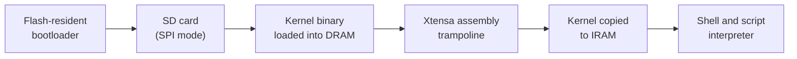

  

-Class_of_2028-203a43?style=flat-square)

<h2 align="center">About</h2>

I'm a third-year B.Tech student in **Artificial Intelligence and Data Science (Honors)** at Vimal Jyothi Engineering College, working at the convergence of **low-level systems architecture, hardware emulation, and machine learning infrastructure**.

<table>
<tr>
<td width="33%" valign="top">

**Systems**

Bare-metal software, custom bootloaders, register-level drivers, and operating system internals where every cycle counts.

</td>
<td width="33%" valign="top">

**Emulation and JIT**

Cycle-accurate emulators for classic hardware, plus just-in-time compilers that translate to native x86-64 machine code.

</td>
<td width="33%" valign="top">

**Machine Learning**

ML fundamentals implemented from scratch, applied NLP research on bias in language models, and quantization for efficient inference.

</td>
</tr>
</table>

<h2 align="center">Tech Stack</h2>

**Systems and Embedded**

**Machine Learning and Data**

**Desktop and Web**

<b>Detailed breakdown</b>

 

| Area | Skills |
|---|---|
| **Low-level** | Bare-metal development, custom bootloaders, memory-mapped I/O, DMA, interrupt handling, FAT32/MBR parsing, Xtensa assembly, x86-64 JIT |
| **Machine learning** | PyTorch, TensorFlow, Transformers, Sentence-Transformers, Scikit-Learn, SciPy, Matplotlib, LSTM time-series models |
| **Application** | Tauri, Angular, TypeScript, C#, FastAPI, Bootstrap |
| **Tooling** | Git, Make, SQL (MySQL), JSON |

<h2 align="center">GitHub Activity</h2>

 

  

<picture>
  <source media="(prefers-color-scheme: dark)" srcset="https://raw.githubusercontent.com/death7654/death7654/output/github-snake-dark.svg" />
  <source media="(prefers-color-scheme: light)" srcset="https://raw.githubusercontent.com/death7654/death7654/output/github-snake.svg" />
  
</picture>

<h2 align="center">Featured Projects</h2>

<table>
<tr>
<td width="50%" valign="top">

### null32
A custom operating system for the ESP32, built from scratch in **C and Xtensa assembly**. A two-stage boot process loads the kernel from an SD card into DRAM, then an assembly trampoline copies it to IRAM. Includes a register-level SPI driver written from the ESP32 TRM, an interactive shell, and a script interpreter for timed GPIO sequences.

</td>
<td width="50%" valign="top">

### JIT Compilers
- **Chip8-JIT-Rust:** high-performance CHIP-8 emulator with an x86-64 just-in-time compiler
- **BrainFuck-Jit:** a brainfuck JIT compiler

</td>
</tr>
<tr>
<td width="50%" valign="top">

### Hardware Emulators
- **Game Boy (DMG):** cycle-accurate Rust emulator with scanline PPU, tile caching, sprite compositing, and OAM DMA timing
- **NES:** emulator engineered in Rust
- **Intel 8080:** full instruction set in C++, timed to run *Space Invaders*
- **CHIP-8 / XO-CHIP:** interpreters in Zig, Rust, and C++

</td>
<td width="50%" valign="top">

### Chrultrabook Tools
Cross-platform utility handling live hardware telemetry, fan curve calculations, and IPC for users running alternate operating systems on Chromebook hardware. **45,000+ downloads.**

</td>
</tr>
<tr>
<td width="50%" valign="top">

### Gender Bias Detection in News Headlines
NLP pipeline with dual-objective training (cross-entropy plus contrastive loss), a neutrosophic membership score for decision uncertainty, and a two-step self-correcting LLM prompting pipeline on SmolLM2-1.7B-Instruct.

</td>
<td width="50%" valign="top">

### ML-Algorithms and Stock Predictor
Fundamental ML algorithms in **C++ with no external math or training libraries**, plus an end-to-end stacked-LSTM forecasting engine with checkpointed incremental training.

</td>
</tr>
<tr>
<td width="50%" valign="top">

### SentinelDeFi
End-to-end streaming pipeline for detecting anomalous DeFi transactions in real time.

</td>
<td width="50%" valign="top">

### BusMitra
Bus crowd-prediction app with ML-based crowd forecasting, built with a Tauri and Rust client and a FastAPI backend.

</td>
</tr>
</table>

### null32 boot flow

<b>All other repositories</b>

 

| Project | Stack | Description |
|---|---|---|
| **FAT32-Reader-Windows** | C | Raw disk parser for inspecting and traversing FAT32 file systems |
| **RumbleGuard** | Rust | Real-time ambient car-cabin noise cancellation using a phone microphone |
| **Chromebook-Driver-Installer** | Rust / Tauri | Chipset matching across 200+ models with metadata updates, no rebuild needed |
| **croskb4-config-generator** | | Build and test keyboard remaps for Coolstar's drivers |
| **AntiPop-For-Chromebooks** | C++ | Eliminates audio popping on stream initialization |
| **chromium-tools** | | Utilities for Chromebooks running Linux |
| **OpenVoice-OpenBox** | TypeScript | Built during FOSSHACK 1.0 |
| **Cherry-Labs** | C# | Desktop client for Gemini models |
| **BinanceTradingBot** | Python | Algorithmic trading script for the Binance API |
| **Quantization-Engine** | Rust | Neural network weight quantization (int8 / int4) |
| **Pothole_Detection_ML_Model** | Python | Machine learning model to detect potholes |
| **Chromebook-Database** | | Hardware compatibility database for Chromebook drivers |
| **Driver-Installer-Linux** | | Driver installer for Chromebooks running Linux |
| **Movie-Ticket-Booking-System** | C | Data structures and algorithms project |
| **Todo_list_rust** | Rust | Minimal command-line task manager |
| **death7654.github.io** | HTML | Website documenting my journey into programming |

<h2 align="center">Screenshots</h2>

<b>Game Boy Emulator (Rust)</b>

  
  
  
  

<b>NES Emulator (Rust)</b>

  
  
  
  

<b>Intel 8080 Emulator (C++)</b>

  
  
  

<b>XO-CHIP Emulator (Zig)</b>

  
  
  

<b>CHIP-8 Emulator (Rust)</b>

  

<b>Cherry Labs (C#)</b>

  

<b>Movie Ticket Booking System (C)</b>

  
  
  

  
  
  

<h2 align="center">Open Source</h2>

Maintaining **Chrultrabook Tools** since May 2023, a cross-platform utility used by 45,000+ people running alternate operating systems on Chromebook hardware.

<h2 align="center">Experience</h2>

<table>
<tr>
<td width="22%" valign="top"><b>May 2026 Jun 2026</b></td>
<td valign="top">

**Research Intern**, Amrita School of Artificial Intelligence

Analyzed linguistic features of gender bias in AI systems with modern NLP, benchmarked classical ML and deep learning models for bias classification, and applied prompt engineering to assess and mitigate bias in LLMs, under Dr. Premjith B.

</td>
</tr>
<tr>
<td width="22%" valign="top"><b>May 2023 Present</b></td>
<td valign="top">

**Open Source Contributor**, Chrultrabook Project

Maintaining Chrultrabook Tools (45,000+ downloads) and managing core hardware compatibility database entries across chipsets and device models.

</td>
</tr>
</table>

<h2 align="center">Education</h2>

**B.Tech, Artificial Intelligence and Data Science (Honors)**, Vimal Jyothi Engineering College, Chemperi | Expected May 2028

<h2 align="center">Connect</h2>

